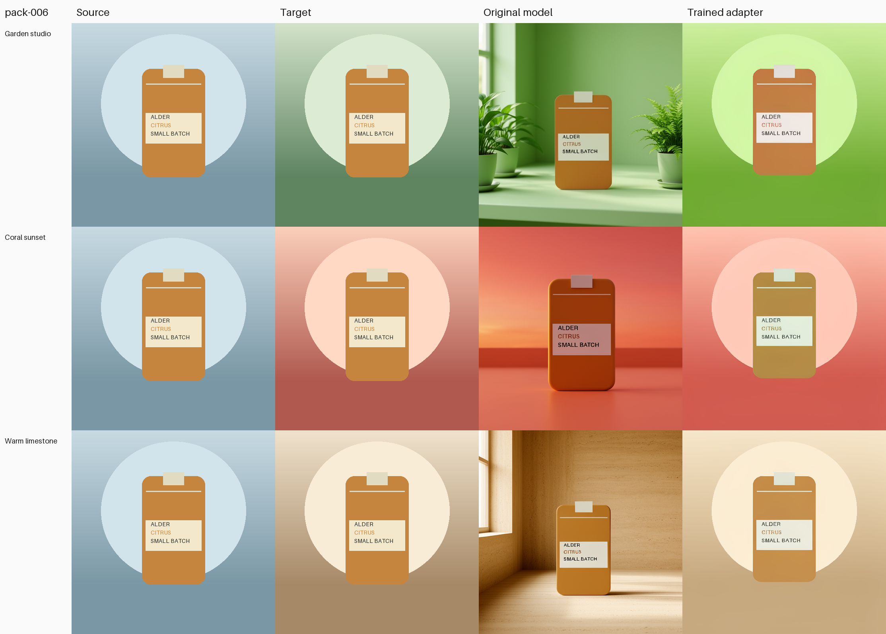

# SceneTune

Fine-tuning FLUX for product photography.

This personal project is separate from [Reflex](https://github.com/1337mus/reflex).

A reference-image editing experiment with **FLUX.2 Klein Base 4B** and three separately trained LoRA adapters: one for flat synthetic backgrounds, one for controlled 3D scenes, and a preservation follow-up. The final approved real-photo pilot compared the original model and both 3D-scene adapters on three development photos; see the [result](docs/real-photo-preservation-result-2026-10-11.md).

The goal is to change product-image backgrounds while keeping products intact. These small development studies do not establish exact product preservation or a broad model ranking.

## New 3D-scene study result (development only)

The signed [source commit 150f8ca](https://github.com/1337mus/scenetune/commit/150f8ca54379bb07f7d39fa7ee180278bf29c824) passed exact [CI run 38128615093](https://github.com/1337mus/scenetune/actions/runs/38128615093). The worker completed all 144 updates.

All 200 adapter tensors across 100 modules changed during training. The saved adapter reloaded, and all nine generated images then matched pixel-for-pixel. Training took 3.1 minutes; the worker took 9.8 minutes on one A100.

| Measure | Original model | 3D-scene adapter | Change |
|---|---:|---:|---|
| Product error against target | 31.97 | 22.22 | 30.5% lower; better in 5/9 edits |
| Product change from source | 32.64 | 23.36 | 28.4% less change; lower in 5/9 edits |
| Background error against target | 87.69 | 14.74 | 83.2% lower; better in 9/9 edits |

Each error is mean absolute RGB channel difference on a 0–255 scale. Lower means smaller pixel error for that comparison.

The evaluation covers nine development edits from three products and one unseen scene family. These are related edits, not nine independent product or scene samples. This study had no sealed test pool.

Visual review found a failure: the adapter often changes the carton color to match the ground color. Some small label text looks distorted.

The scores do not establish label text correctness or product-shape preservation. The later matched real-photo comparison is a separate study. Keep these results separate from the first study; they do not establish an overall winner.

The study used one A100 and the existing $15 pilot. Delayed gross workspace usage rose from $5.52 at launch to $6.14 at the 09:50:40Z check (+$0.62). Net usage was $0 after credits. This is delayed workspace usage, not the final invoice for this run. Assistant-token costs are separate.

The launcher reported a shutdown-confirmation error. A later read-only check at 09:44:18Z confirmed the app was stopped, with zero tasks and no other active apps.

[Full 3D-scene study report](docs/controlled3d-study-result-2026-10-11.md).

## 3D-scene preservation follow-up (development only)

The fresh preservation LoRA lowered mean product-source pixel error by 10.39% versus the prior 3D adapter, but improved only 4/9 edits and missed the background-error limit by a small margin. The combined development goals were not met. Pixel metrics do not score text correctness or overall image quality. [Full preservation study report and contact sheets](docs/preservation-study-result-2026-10-11.md).

## Real-photo preservation comparison (development only)

The approved pilot compared the original model, the prior 3D-scene adapter, and the fresh preservation adapter on the same three development photos. All nine outputs changed product position and/or size; visual review found no clear overall quality improvement. Geometry changes make masked product-pixel scoring inapplicable for the two full-package photos. The third photo is a cropped package front. [Full report](docs/real-photo-preservation-result-2026-10-11.md).

## First synthetic study: flat-background targets

The first study used the original synthetic packaging images.

**Training reduced pixel error on all nine development examples.**
The original model and trained adapter used the same source images, prompts and random seed.

| Measure | Original model | Trained adapter | Change |
|---|---:|---:|---:|
| Average product-pixel error | 58.00 | 11.93 | 79.4% lower; better in 9/9 cases |
| Average background error against the target | 64.80 | 17.19 | 73.5% lower; better in 9/9 cases |
| Product pixels changed by more than 8 color levels | 99.21% | 91.90% | Lower in 8/9 cases; higher in 1/9 |
| Saved-adapter replay | — | Exact match in 9/9 cases | Zero pixel difference after reload |

Error is the average absolute RGB channel difference on a 0–255 scale. Lower is better.
Product error compares with the source; background error compares with the synthetic target.
The figures are equal-weight averages across nine examples from three products kept out of training.

The adapter learned our flat, synthetic target style. The original model produced more photographic scenes.
Lower pixel error here does not establish better photos. The development products were new, but the background styles appeared in training.

**The product is still not preserved exactly.** Many pixels change even after training.
These checks do not measure label readability, image realism or performance on real photos.
There is no claim of beating other image models.

[Read the full study and see all nine examples](docs/matched-study-result-2026-10-09.md).



## Earlier real-photo R2: first flat-background adapter

This earlier R2 tested the original model against the first flat-background adapter in seven 512×512 generations on three development products (3 base, 3 adapter, 1 strict-load repeat), with zero training; the repeat matched pixel-for-pixel. [Run details](docs/real-photo-comparison-result-2026-10-10.md).

Raj selected the original model in all three cases (Barilla A, Kinder Bueno B, Cruesli A). This records overall preference only; geometry, label correctness and background ratings remain pending. This preference does not apply to the later two-adapter comparison. Three cases do not establish a broad ranking.

## Scene-data checks

The checker is in the [signed source commit](https://github.com/1337mus/scenetune/commit/ed9e7f73f18d82874e2b7ae80c2a1722b0d22f98); [exact CI run 38110439968, attempt 1](https://github.com/1337mus/scenetune/actions/runs/38110439968) passed on it.

The checker compares recorded product shape, label and font, camera, lighting, materials and render settings. Only wall color may change. It checks the captured records, not whether every scene setting was captured.

| Check | Result |
| --- | --- |
| Project tests | 230 passed |
| New scene tests | 87 passed |
| Code checks | lint, format, types passed |
| R4 | Failed before images: Blender Vector type stopped capture. |
| R5 probe | Failed before snapshots or images: the Render Layers current-scene link was rejected. |
| R6 probe | Passed with 4 snapshots and 0 images. |
| R6 preview | Failed after 1 image: recorded scene fields no longer matched. |
| R7 probe | Passed with 4 snapshots and 0 images. |
| Controlled R7 preview | Passed: 4 CPU images in 55.0 s total, 2 threads, 96 samples. |
| Varied-studio R7 render | Structural checks passed: 12 CPU images; 220.615 s wrapper time; 0 GPU runs and 0 training updates. |

R4, R5, and R6 preview evidence was saved. Their processes stopped and mounts were detached. There were no GPU runs or training updates.

The controlled-studio R7 preview passed its strict checks, but did not explain the earlier R6 failure or prove a general fix. The later varied-studio R7 render produced 12 development images. Masks match across variants and product positions appear stable as wall colors change. Grain, low contrast, a protruding flat jar label board, and rigid-looking pouch packaging remain. This preview does not approve image quality or data use.

[Varied-studio R7 report and contact sheets](docs/varied-studio-preview-2026-10-11.md) · [Controlled-studio R2/R3 results](docs/controlled-studio-preview-2026-10-10.md).

## Fresh 3D data checks

A separate validator and training export are now implemented. The original dataset route stays intact.

- **Keep pools separate.** Each product and whole background family belongs to one pool.
- **Check the actual files.** Verify scene records, source pins, images and product masks.
- **Protect reserved tests.** Check their metadata without opening their files.
- **Export training data only.** Match each reference photo to the correct target, even when the input order changes.

These checks do not approve visual quality or prove that every scene setting was captured. A trusted caller must provide a reviewed registry. The approved export fed the 2026-10-11 study above; those development results do not clear another GPU run.

[Validator contract and limits](docs/controlled3d-validation.md).

The corrected fresh preview produced **8 CPU images from 2 original products**.
Larger, darker labels passed visual review. The independent check verified all
eight images, their product masks and the recorded scene states. No new model training ran; these
fixtures stay outside new training pools.

[Fresh preview, all eight images and next steps](docs/fresh-3d-preview-2026-10-11.md).

## What we built

- A paired dataset with source images, target images and product masks.
- Separate product identities for training, development and reserved tests.
- A bounded Modal training job with pinned code, data and model components.
- Adapter saving and strict loading into a fresh model.
- Matched image generation and an independent check of the weights, training records and scores.

The laptop runs CPU checks only. Model downloads, generation and training run on Modal.
No employer data or paid LLM-generated labels are used.

## First synthetic study training run

| Item | Result |
|---|---|
| Training data | 18 pairs from 6 products |
| Development data | 9 pairs from 3 different products |
| Reserved tests | 9 pairs from 3 more products; still closed |
| Training | 8 passes over the data; 144 updates; one adapter |
| LoRA | Rank 32; 48,168,960 learned values across 100 modules |
| Training checks | All 144 losses finite; all 144 gradient records finite and nonzero |
| Saved weights | 200 tensors restored; all 200 changed during training |
| Image settings | 512×512; seed 7321; 16 steps; guidance 4; 27 total generations |
| Training time | 176.13 seconds |
| Worker time | 489.91 seconds through receipt creation; excludes archive packing |
| Peak memory allocated by Torch | 17.55 GiB; not total GPU memory |
| Compute | One A100-80GB; one call; zero retries |
| Shutdown | Direct check confirmed stopped, zero tasks, no active apps |

[Training design](docs/matched-study.md) · [Pinned trainer and model components](docs/trainer-contract.md)

## Cost: first synthetic 144-update study

These figures describe the first synthetic study, not the later 3D-scene study or the R2 run. The pilot allowance is **$15**. The larger $100–$150 experiment budget has not been used.

| Cost evidence | Amount |
|---|---:|
| Estimate at the full configured time limit | $2.66544 |
| Delayed gross workspace meter after the study | $5.35417914 |
| Net workspace bill after credits at that check | $0 |
| Final charge for this run | Unknown |

The workspace meter includes earlier work. It can lag and change.
The estimate excludes build, storage, transfer, idle grace and tax. It is not a provider spending cap.
Assistant-token costs are separate and are not included here.

## Earlier runs and failures

| Run | What it established |
|---|---|
| Pilot R1 / R2 | Provider configuration failures before GPU inputs; evidence retained privately |
| Real-photo R1 | Runtime import failed before model loading; no outputs or scores; failure evidence retained |
| Real-photo R2 | Seven generations, zero training; original model preferred 3/3 by one reviewer; geometry, label and background ratings pending |
| [R3](docs/pilot-result-2026-10-08.md) | Eight training updates worked, but the saved-adapter replay failed |
| [Reload diagnostic](docs/reload-result-2026-10-09.md) | Separate-weight loading matched exactly; combined-weight loading failed the fixed limits |
| [R4](docs/pilot-result-2026-10-09-r4.md) | Fresh eight-update training and exact replay passed; no quality improvement established |
| First synthetic 144-update study | Better synthetic pixel scores; exact replay; all nine cases reported |

In the first synthetic 144-update study, the launcher reported a shutdown-confirmation error after the worker passed.
The first independent closure check for that study also failed on the CLI’s workspace-name format.
A corrected read-only check then confirmed the app was stopped with zero tasks. Both errors remain recorded.

## Next

The approved $15 pilot is closed. The real-photo comparison found product-position or size changes in every output and did not establish a clear quality improvement. Keep Barilla, Kinder Bueno and Quaker Cruesli out of training and testing. Any future improvement study needs broader realistic paired targets and untouched test photos; this result does not authorize another training run.

## Development

```sh
uv sync --locked
uv run --locked pytest -q
uv run --locked ruff check .
uv run --locked ruff format --check .
uv run --locked mypy src
```

Code: MIT. Model components keep their upstream licenses.
Original generated dataset images: CC0-1.0.

Model: [FLUX.2 Klein Base 4B](https://huggingface.co/black-forest-labs/FLUX.2-klein-base-4B).
