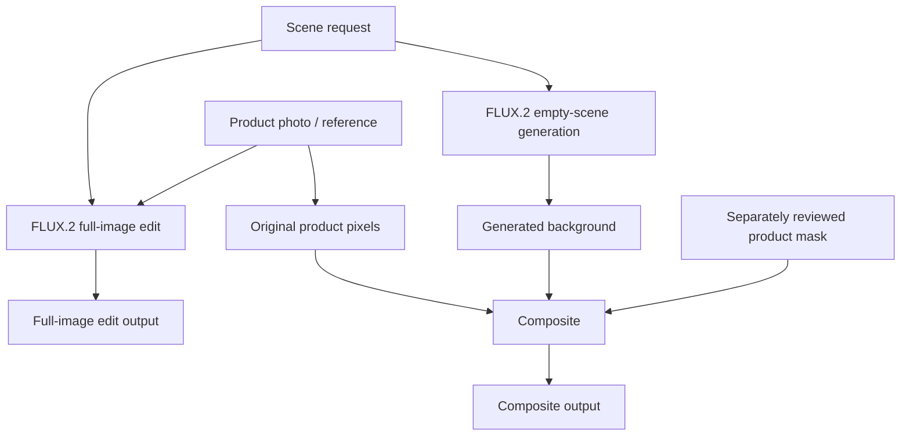

# SceneTune

Goal: Change the background of a product photo without changing its shape, colors, or label.

**Status: Completed research experiment.** Synthetic pixel scores improved, but real-photo editing did not show clear improvement. This personal portfolio project uses **FLUX.2 Klein Base 4B**; it is not a production editor.

Three **LoRA adapters** were trained for flat synthetic backgrounds, controlled 3D scenes, and a product-preservation follow-up. A LoRA is a small set of low-rank trainable weights attached to a base model; the 4B model itself was not fully retrained.

## How it works

1. Pair product images with target scenes and separately reviewed masks. Split training and evaluation by product identity; the controlled 3D study also held out a scene family.
2. Train adapters on synthetic data.
3. Compare each adapter with the same base model using matched prompts and image settings; measure pixel error against product sources or scene targets.
4. Save each adapter, load it into a fresh base model, and check records, weights, metrics, and exact replay outputs.

The final real-photo comparison tested two paths. The full-image path edits the photo from a scene request. The composite path generates an empty scene, then places the original product pixels using a separately reviewed mask.



## Results

| Study | Main result | Scope |
|---|---|---|
| Flat synthetic backgrounds | Product-source pixel error: **58.00 → 11.93**. Background-target error: **64.80 → 17.19**. | 9 development edits from 3 held-out products; background styles appeared in training |
| Controlled 3D scenes | Product-target error: **31.97 → 22.22**; product-source error: **32.64 → 23.36**; background-target error: **87.69 → 14.74**. | 9 development edits; one unseen scene family |
| Preservation follow-up | Product-source error was **10.39% lower** than the prior 3D adapter, improving 4/9 edits. The background-error goal was missed. | 9 development edits; combined goals not met |
| Real-photo adapter pilots | No clear quality transfer. In the three-photo follow-up, all 9 outputs changed product position and/or size. | Small development-only pilots |
| Protected-product comparison | Composite protected pixels were exact in **24/24** cases. **0/18** reserved cases were usable for either method under assistant review. **52 calls, 78 PNGs, zero training updates.** | 24 selected catalog photos; 6 development / 18 reserved |

One reviewer preferred the base model in all three cases in an earlier development-only photo pilot (**base 3/3; first flat-background adapter 0/3**). No fresh human-preference study was run for the later two-adapter comparison.

Compositing preserved protected source pixels exactly in all 24 cases. That is a compositor guarantee, not evidence of learned model preservation.

Quality still failed: 0/18 reserved cases were usable with either method under assistant review, and all 24 composites had poor ground contact.

Pixel error is mean absolute RGB-channel difference on a 0–255 scale; lower means closer to the chosen source or target. It does not measure photo realism or text correctness. These small studies do not establish a broad model ranking or production quality.


*One held-out synthetic product in three scenes. Columns: source, target, base model, LoRA. Better pixel scores did not establish better real photographs.*

## What this demonstrates

- Reproducible ML experiment engineering: pinned code, data, model components, and bounded training jobs.
- Study-specific evaluation splits by product identity and, for the controlled 3D study, scene family; matched inputs and explicit limits on held-out evidence.
- Adapter save/reload checks, exact fresh-load replays, and independent validation.
- Failure analysis across synthetic and selected real-photo cases, including product geometry, scene contact, and label limitations.

## Public reproduction

The public repository includes CPU code and tests plus published synthetic contact sheets. It does **not** include model checkpoints, real-source photos, or frozen raw private audit evidence.

The GPU runners are pinned and guarded for the original account and expect a reviewed payload and compute clearance. The public quickstart verifies the CPU pipeline. GPU reproduction requires your own account, configuration, and inputs.

**CPU quickstart** (requires [Python 3.12](https://www.python.org/downloads/) and [uv](https://docs.astral.sh/uv/)):

```sh
uv sync --locked
uv run --locked pytest -q
uv run --locked ruff check .
uv run --locked ruff format --check .
uv run --locked mypy src
```

On the reviewed code head, [exact CI run 38201588561](https://github.com/1337mus/scenetune/actions/runs/38201588561) passed **562 tests** plus lint, format, and type checks.

## Repository map

| Path | Contents |
|---|---|
| `src/` | Experiment and training code |
| `experiments/` | Experiment definitions, manifests, and receipts |
| `tests/` | CPU tests for code and experiment contracts |
| `docs/` | Methods, results, failure reports, and synthetic contact sheets |

## Status and reports

The experiment is closed; more epochs are not planned. Future work needs realistic training pairs that teach empty backgrounds, placement, and contact shadows. It would then need a fixed study plan, a budget, and untouched test products.

- [Flat-background study, methods, and contact sheets](docs/matched-study-result-2026-10-09.md) · [training design](docs/matched-study.md)
- [Controlled 3D-scene study](docs/controlled3d-study-result-2026-10-11.md) · [preservation follow-up](docs/preservation-study-result-2026-10-11.md)
- [Real-photo comparison](docs/real-photo-preservation-result-2026-10-11.md) · [earlier pilot](docs/real-photo-comparison-result-2026-10-10.md) · [failed attempt](docs/real-photo-comparison-attempt-2026-10-10.md)
- [Protected-product comparison: all cases and limits](docs/protected-product-comparison-result-2026-10-12.md) · [protocol](docs/protected-product-comparison.md) · [R1 failure report](docs/protected-product-comparison-failure-2026-10-12.md)
- [Earlier training pilots](docs/pilot-result-2026-10-08.md), [R4](docs/pilot-result-2026-10-09-r4.md), and [adapter reload diagnostic](docs/reload-result-2026-10-09.md)
- [Scene-data validation](docs/controlled3d-validation.md) · [fresh CPU preview](docs/fresh-3d-preview-2026-10-11.md) · [varied-scene preview](docs/varied-studio-preview-2026-10-11.md)

## License and data

Code: [MIT](LICENSE). Original procedural source and target images: [CC0-1.0](https://creativecommons.org/publicdomain/zero/1.0/). Contact sheets also contain identified model-generated examples. Model weights, fonts, and third-party photos have separate terms; see [third-party notices](THIRD_PARTY_NOTICES.md).
