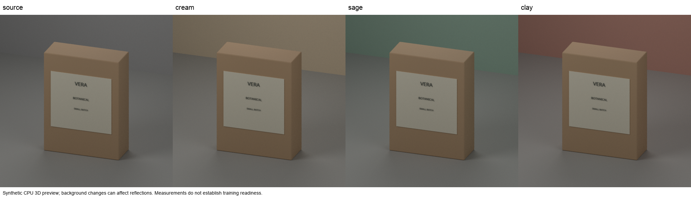

# Controlled studio preview result (2026-10-10)

Status: R2 and R3 produced a useful, measurable scene recipe. Training expansion remains held.

## Scene and controls

Each run rendered four complete 512×512 Cycles scenes: source, cream, sage, and clay. The scene contains one newly generated carton, its original label, and a support plane with a contact shadow.

The camera is orthographic. Within each four-render run, subject geometry and silhouette, label, camera, lights, world, seed, and render settings stay fixed. Only the background wall's diffuse color changes between variants. Each image is a full-scene render; no cutout compositing or post-render product-pixel repair was used.

The label reads **SORA / BOTANICAL / SMALL BATCH** in every panel. Root found it readable by visual inspection. No user or OCR score was collected.

R2 and R3 use the same camera, subject, labels, wall colors, and masks. Light powers changed between runs as shown below.

## Attempts and execution

| Run | Samples | Key / fill / rim | Wall time | Outcome |
| --- | ---: | --- | ---: | --- |
| R1 | 32 | 55 / 22 / 28 W | 17.3 s | Visual gate failed: 262,081 / 262,144 white pixels in the source image (99.976%). Preserved as a failure. |
| R2 | 32 | 0.55 / 0.22 / 0.28 W | 18.7 s | Geometry, support contact, and label were usable; exposure was dim and render noise remained. |
| R3 | 96 | 1.10 / 0.44 / 0.56 W | 52.1 s | Brighter than R2, with visible grain still present. Recipe preparation only. |

Each run was CPU-only with two fixed threads, four renders, and a 720-second wall-time bound. There were zero automatic retries, model or inference calls, training updates, or new GPU runs. R2 and R3 exited successfully and their processes ended.

## Scene-data checks

The checker is in the [signed source commit](https://github.com/1337mus/scenetune/commit/ed9e7f73f18d82874e2b7ae80c2a1722b0d22f98); [exact CI run 38110439968, attempt 1](https://github.com/1337mus/scenetune/actions/runs/38110439968) passed on it.

The checker compares recorded product shape, label and font, camera, lighting, materials and render settings. Only wall color may change. It checks the captured records, not whether every scene setting was captured.

| Check | Result |
| --- | --- |
| Project tests | 230 passed |
| New scene tests | 87 passed |
| Code checks | lint, format, types passed |
| R4 | Failed before images: Blender Vector type stopped capture. |
| R5 probe | Failed before snapshots or images: the Render Layers current-scene link was rejected. |
| R6 probe | Passed with 4 snapshots and 0 images. |
| R6 preview | Failed after 1 image: recorded scene fields no longer matched. |
| R7 probe | Passed with 4 snapshots and 0 images. |
| R7 preview | Passed: 4 CPU images in 55.0 s total, 2 threads, 96 samples. |

We checked all four saved-scene snapshots, raw mesh hashes, region counts, and contact-sheet panels against their source pixels. The masks matched: 81,066 product pixels (78,666 core and 2,400 edge), 181,078 background pixels, box `[130, 80, 382, 432]`, and no white pixels.

No checks were removed or thresholds relaxed.

| Wall color | Product mean absolute RGB difference | Background mean absolute RGB difference |
| --- | ---: | ---: |
| Cream | 0.341 | 6.193 |
| Sage | 0.117 | 2.354 |
| Clay | 0.293 | 6.449 |

Mean absolute RGB difference averages channel errors on a 0–255 scale, comparing each variant with the source. Full-precision values are in the private audit at `.context/controlled-studio-preview-r7/audit.json`. These values measure pixel change, not image quality.

We visually checked the contact sheet. Box and label positions stayed stable, wall shades changed, and lighting and contact shadows were present. Grain and subdued contrast remain. The review used no OCR and collected no user quality rating.

R6’s failure cause remains unresolved. R7 passing does not diagnose it or prove a general fix. These checks do not establish image quality, label readability, dataset use, or training readiness.

R4, R5, and R6 preview evidence was saved. Their processes stopped and mounts were detached. The R7 run is closed and development-only. There were no GPU runs or training updates.

Next is varied development-scene implementation.

## R2 and R3 measurements

Both audits found four decoded-identical binary object-index masks, no white pixels, an unclipped bounding box of `[130, 80, 382, 432]`, and exact contact-sheet panels. The mask covers 81,066 product pixels: a 78,666-pixel eroded core and a 2,400-pixel edge band. There are 181,078 background pixels.

Mean RGB differences average absolute channel differences on a 0–255 scale, comparing each target with the source. A pixel counts as changed when any channel differs. “Product >8” counts product pixels whose maximum channel difference is greater than 8.

| R3 target | Product | Core | Edge | Background | Product changed | Product >8 pixels |
| --- | ---: | ---: | ---: | ---: | ---: | ---: |
| Cream | 0.340 | 0.314 | 1.191 | 6.192 | 43.8% | 108 |
| Sage | 0.117 | 0.108 | 0.419 | 2.354 | 25.7% | 0 |
| Clay | 0.293 | 0.268 | 1.100 | 6.449 | 39.6% | 19 |

R2 product color difference is included for history:

| R2 target | Product mean RGB difference |
| --- | ---: |
| Cream | 0.305 |
| Sage | 0.103 |
| Clay | 0.262 |

The decoded masks and stable silhouette support a fixed-geometry comparison. Wall-reflected light changes product color, while the outline remains fixed. Product changed-pixel counts are measurements; they do not promise exact product pixels or establish a quality score.

## Limits and follow-up

R3 is brighter than R2, and visible render grain remains. These runs cover one procedural subject and one studio/background family. They provide no evidence about real product photos or model performance, and they do not complete a training set. Keep the previews out of the dataset manifest and training exports.

The existing dataset validator remains unchanged and continues to require exact foreground pixels for its current pair schema. A separate controlled-3D pair schema and validator need independent review; the proposal is in [Controlled 3D data plan](controlled-studio-data-plan.md). The original R1 failure is retained. Raw renders, scene files, and helper scripts remain ignored; this report does not embed preview images.

Evidence basis: the ignored R2 and R3 audit and root-review records. Their measurements are reported here without broader photo-quality or model-ranking claims.
