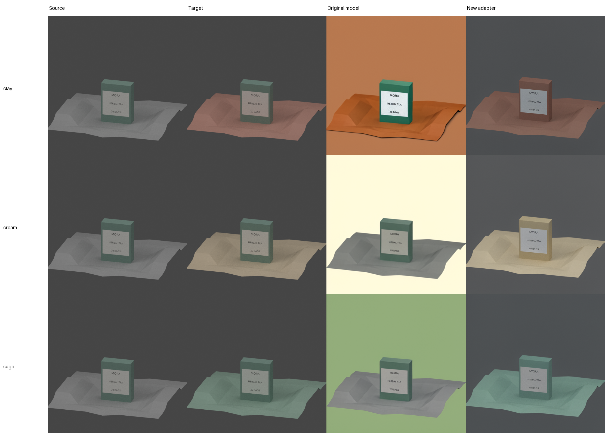
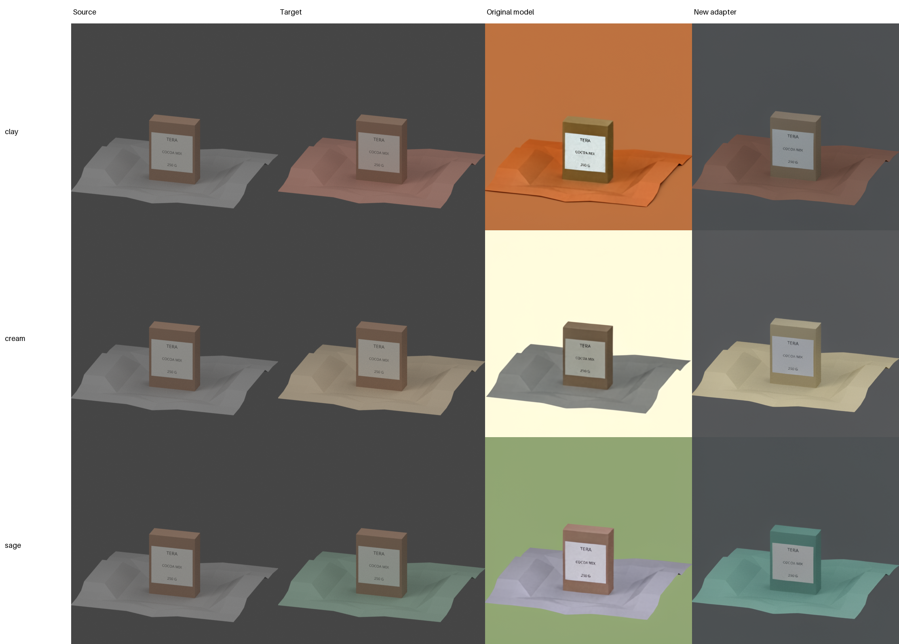
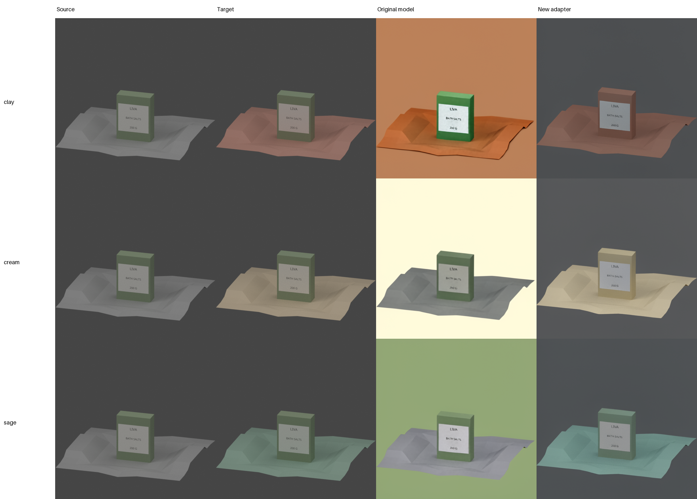

# Controlled3D 144-update study result

Background edits improved on this small synthetic set. Product results were mixed.

## Run

| Fact | Result |
|---|---|
| Evidence | source `150f8ca54379bb07f7d39fa7ee180278bf29c824`; [CI run #38128615093](https://github.com/1337mus/scenetune/actions/runs/38128615093) passed |
| Training | 144 updates; 18 edits across 6 products |
| Development | 9 edits across 3 products; one unseen scene family |
| Test pool | No sealed test pool was used |
| GPU | 1 × A100-80GB |
| Time | 3.1 min training; 9.8 min full worker |
| Adapter | 200/200 tensors changed across 100 modules |
| Reload | 9 image checks passed |
| Peak GPU memory | 18.84 GB / 17.55 GiB |

The launcher's shutdown check recorded an error at 2026-10-11T09:43:23.148766+00:00: Modal did not confirm that the matched-study app stopped. The later root observation at 2026-10-11T09:44:18.380751+00:00 confirmed this exact app and call were stopped with zero tasks and no other active apps. The original failure record is preserved.

## Pixel metrics

Unweighted means cover nine edit states. Each is average RGB pixel difference: mean absolute error over assessed pixels, with red, green, and blue channels each spanning 0–255. Lower target or background error means closer pixel agreement with reference. Three products each contribute clay, cream, and sage states, so these are not nine independent product samples. Trained and reloaded images were pixel-identical in all nine edits.

| Measure | Original | Adapter | Improved edits |
|---|---:|---:|---:|
| Product error against target | 31.97 | 22.22 | 5/9 |
| Product change from source | 32.64 | 23.36 | — |
| Background error against target | 87.69 | 14.74 | 9/9 |

Mean target product error fell 30.5%; background error fell 83.2%. The target error was lower on 5 of nine edits, showing mixed per-edit product results. Product change from source is descriptive, not a quality score.

Separate source-to-target product baseline (lighting changes): 3.29 mean channel error across nine edits.

### Every development edit

Lower pixel error means closer agreement with the target. These are pixel scores, not ratings of realism or readable text.

| Product / edit | Product: original | Product: adapter | Background: original | Background: adapter |
|---|---:|---:|---:|---:|
| 201 / clay | 51.12 | 20.29 | 52.58 | 9.87 |
| 201 / cream | 10.69 | 31.05 | 141.09 | 20.02 |
| 201 / sage | 15.00 | 16.77 | 65.47 | 12.21 |
| 202 / clay | 46.81 | 14.17 | 52.09 | 11.43 |
| 202 / cream | 13.93 | 28.37 | 142.96 | 21.44 |
| 202 / sage | 45.90 | 25.12 | 67.47 | 12.78 |
| 203 / clay | 54.34 | 16.62 | 58.66 | 10.41 |
| 203 / cream | 14.82 | 30.53 | 143.31 | 21.31 |
| 203 / sage | 35.12 | 17.03 | 65.57 | 13.18 |

### Product averages

Per-product means average clay, cream, and sage:

| Product | Measure | Original | Adapter |
|---|---|---:|---:|
| 201 | Product error against target | 25.60 | 22.70 |
| 201 | Product change from source | 26.12 | 24.05 |
| 201 | Background error against target | 86.38 | 14.03 |
| 202 | Product error against target | 35.55 | 22.55 |
| 202 | Product change from source | 36.44 | 23.32 |
| 202 | Background error against target | 87.51 | 15.21 |
| 203 | Product error against target | 34.76 | 21.39 |
| 203 | Product change from source | 35.36 | 22.71 |
| 203 | Background error against target | 89.18 | 14.97 |

## What the images show

- The adapter more closely follows the target background colors.
- It often changes the carton color to match the ground color. The target keeps the carton color mostly unchanged.
- Some small label text looks distorted. No formal text accuracy score was measured.

These observations cover all nine displayed edits. They do not prove performance on real photos.

## Contact sheets

Each sheet has four columns and three rows. Source, target, original model, and new adapter images retain their full 512×512 RGB pixels; labels are in sheet margins.

### dev-201

### dev-202

### dev-203

## Workspace meter

| Snapshot | Gross metered | Net billed |
|---|---:|---:|
| Launch baseline | $5.52 | $0.00 |
| Closed workspace | $6.13 | $0.00 |
| Workspace change | $0.61 | $0.00 |

A later delivery check at 09:50:40Z recorded **$6.14 gross** and **$0 net** after credits. The workspace increase since launch was **$0.62**. The same app remained stopped with zero tasks and no other active apps.

These are workspace totals, not a SceneTune invoice. The delayed meter change is not attributable to this run; token usage is separate.

## Limits

Pixel similarity does not establish readable label text, shape, realism, or general image quality. This synthetic result covers three dev products in one unseen scene family, without a sealed test pool. No overall quality score is reported.
