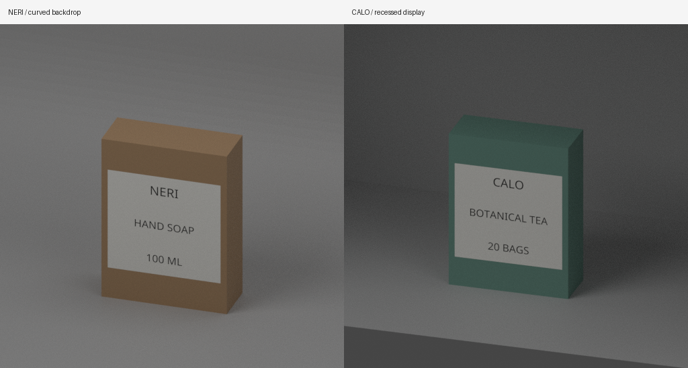
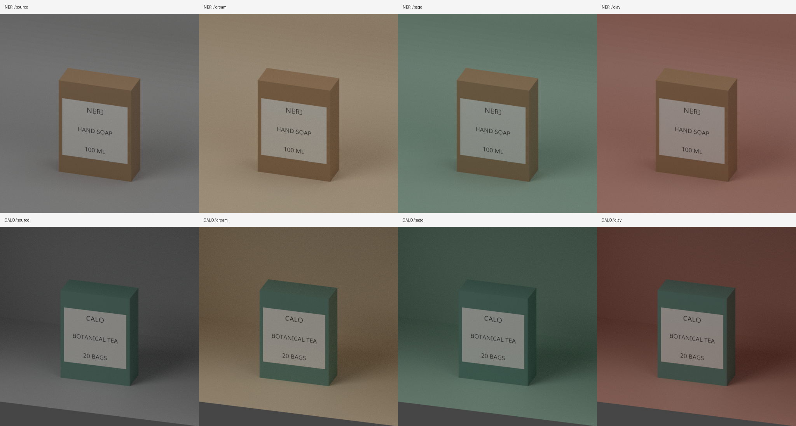
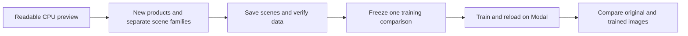

# Fresh 3D preview — October 11, 2026

**The labels are readable. The preview checks passed. No new model training ran.**

We built two original cartons in different scenes. NERI sits in front of a
curved backdrop. CALO sits in a recessed display. Each scene has four background
colors. These are small pipeline fixtures, not a training dataset.

## What changed

- Larger text for the small words and quantities.
- A lighter label panel and darker text.
- The same camera, lighting, product shape and render settings.

The earlier preview remains saved. It failed visual review because its small
text was hard to read. The correction improves these rendered labels. It is not
an improvement measured on the image model.

## Checks and time

| Measure | Corrected preview |
|---|---:|
| Products | 2 |
| Images | 8 at 512 × 512 |
| Product masks | 8; identical within each product |
| Scene-state checks | 8 before rendering + 8 after rendering |
| Full mesh records | 96 |
| Focused CPU tests | 25 passed |
| Rendering time | 118.497 seconds |
| Complete process time | 354.568 seconds |
| Launcher time, including mount cleanup | 365.239 seconds |
| GPU runs / training updates | 0 / 0 |
| Automatic retries | 0 |

Every recorded scene field matched before and after each render. Each mask had
a nonempty interior and stayed inside the image. All eight images had zero
fully white clipped pixels under the fixed check. File and mask hashes matched.
The process ended and its owned Blender mount was detached.

The 96 mesh records cover all six meshes in each scene, across four colors and
two capture phases. That count is evidence coverage, not 96 independent tests.
The checker still relies on the reviewed capture format; it cannot prove that
unrecorded settings never changed.

## All eight images

Each tile below keeps its original 512 × 512 pixels. Columns show source,
cream, sage and clay. Rows show NERI and CALO.

## Limits

- Fine grain remains. These are simple rendered cartons, not real product photos.
- Most backdrop features sit outside the crop. The next scenes must show their
  defining features while keeping the product label readable.
- Readability is a visual check by the project reviewer. No OCR score was measured.
- Two products cannot show broad image quality or model improvement.
- These preview products and background families stay out of new training pools.
- No saved Blender scene was requested for this mechanics run. It cannot satisfy
  the saved-scene pin required for a real data export.
- Earlier failures and the original preview remain preserved privately.
- The Blender builder is a local prototype. Repository CI checks the production
  validators; it did not run the local Blender scripts. Those scripts received
  separate source review, pinned hashes and CPU checks.

## What comes next

The next dataset needs more original products and separate background families
for training and development. Its launch will save scenes and pin the exact
Blender executable. GPU training still needs reviewed data, a fixed run plan,
current account usage and prices, and passing CI on the exact source.

The pilot allowance remains **$15**. The larger $100–$150 allocation is unopened.
This CPU preview added no Modal compute. Assistant-token costs are separate.
