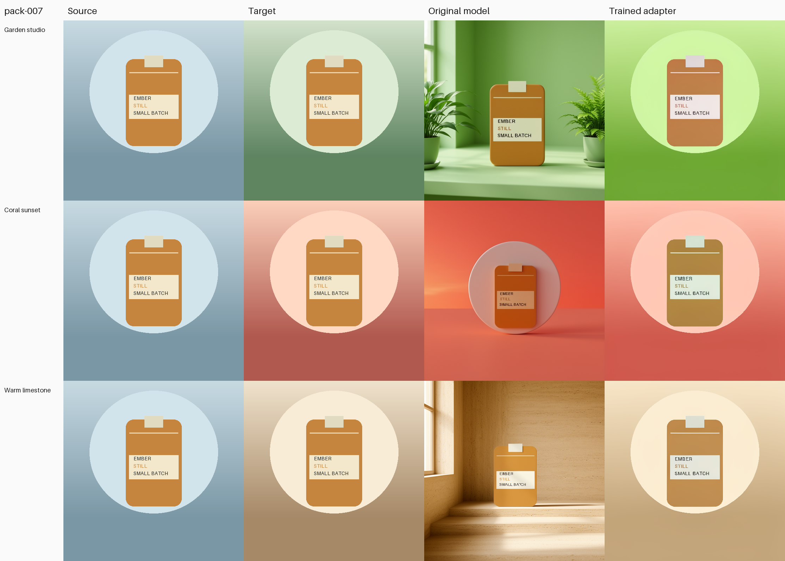
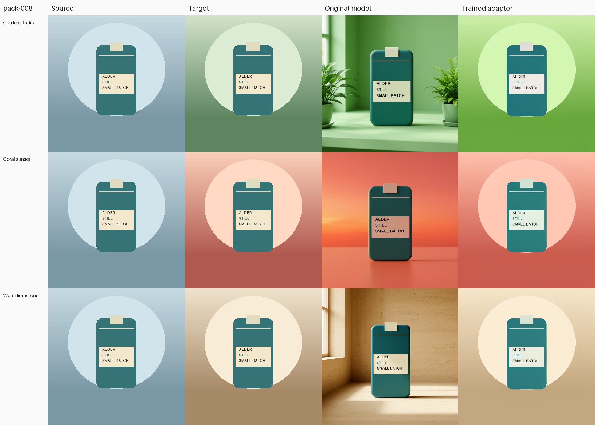

# Image-editing study: what 144 training updates changed

**The adapter learned our synthetic target style.** Product and background pixel errors fell in all nine development examples.
Saving and reloading the adapter reproduced all nine trained images exactly.

The original model produced more photographic scenes. The trained adapter produced flatter graphics, closer to our targets.
Lower pixel error here does not establish better photographs.

## Result at a glance

| Measure | Original model | Trained adapter | Result |
|---|---:|---:|---|
| Average product-pixel error | 58.00 | 11.93 | 79.4% lower; improved in 9/9 cases |
| Average background error | 64.80 | 17.19 | 73.5% lower; improved in 9/9 cases |
| Product pixels changed by more than 8 color levels | 99.21% | 91.90% | Improved in 8/9 cases; worsened in 1/9 |
| Trained vs reloaded image difference | — | 0 | Exact match in 9/9 cases |

Error means average absolute RGB channel difference on a 0–255 scale. Lower is better.
Product error compares with the source image. Background error compares with the target image.
Changed-pixel percentages count pixels where any channel differs by more than 8.

Each example has equal weight in these averages. The nine examples share just three product identities.
The three background styles also appear in training. We held out products, not background styles.

## All nine examples

| Product / scene | Product error: original → trained | Background error: original → trained | Changed product pixels: original → trained |
|---|---:|---:|---:|
| pack-006 / Garden studio | 59.61 → 9.66 | 70.86 → 27.64 | 99.99% → 48.44% |
| pack-006 / Coral sunset | 66.72 → 14.04 | 49.18 → 10.86 | 100.00% → 99.75% |
| pack-006 / Warm limestone | 51.18 → 11.71 | 75.23 → 16.02 | 99.76% → 95.30% |
| pack-007 / Garden studio | 66.23 → 9.96 | 72.79 → 27.35 | 99.90% → 99.60% |
| pack-007 / Coral sunset | 54.15 → 11.66 | 50.63 → 11.03 | 100.00% → 99.81% |
| pack-007 / Warm limestone | 44.49 → 12.16 | 72.10 → 14.26 | 96.75% → 98.93% |
| pack-008 / Garden studio | 56.54 → 12.29 | 75.31 → 22.14 | 99.26% → 99.03% |
| pack-008 / Coral sunset | 63.45 → 13.07 | 48.53 → 10.35 | 100.00% → 99.80% |
| pack-008 / Warm limestone | 59.65 → 12.85 | 68.61 → 15.02 | 97.19% → 86.42% |

In every example, 100% of background pixels changed by more than 8 color levels, for both models.
That confirms a background change. It does not show whether the change looks good.

## See the difference

Columns: **Source · Target · Original model · Trained adapter**.
Rows: **Garden studio · Coral sunset · Warm limestone**.
Every panel keeps its original 512×512 pixels. Only the surrounding labels were added.

### Product 006

### Product 007

### Product 008

## What ran

| Setting | Value |
|---|---|
| Model | FLUX.2 Klein Base 4B |
| Training data | 18 image pairs from 6 products |
| Development data | 9 image pairs from 3 other products |
| Reserved tests | 9 pairs from 3 more products; content remains closed |
| Training schedule | One fresh adapter; 8 passes; 144 updates |
| LoRA rank / learning rate | 32 / 0.0001 |
| Batch size / gradient accumulation | 1 / 1 |
| Training seed | 20261008 |
| Image generation | Same source, prompt and seed 7321 for each comparison |
| Image settings | 512×512; 16 steps; guidance 4 |
| Outputs | 9 original + 9 trained + 9 reloaded images |
| Compute bound | One A100-80GB; 4 CPU cores; 64 GiB RAM; one call; zero retries |
| Time limits | 300 seconds startup; 2,700 seconds for the function |

The laptop stayed CPU-only. The dataset uses original procedural packaging images.
No employer data or paid LLM-generated labels were used.

## Training and saved weights

| Check | Verified result |
|---|---|
| Completed updates | 144/144 |
| Finite losses | 144/144 |
| Finite, nonzero gradient records | 144/144 |
| Training time | 176.13 seconds |
| Average logged step time | 1.22 seconds |
| Worker time through receipt creation | 489.91 seconds; excludes archive packing |
| Peak memory allocated by Torch | 17.55 GiB; not total GPU memory |
| Saved learned values | 48,168,960 |
| Saved / restored tensors | 200 / 200, across 100 modules |
| Tensors changed during training | 200 |
| Largest logged parameter change | 0.01428223 |
| Logged loss range | 0.00445767–0.08903717 |
| Mean loss, first / last 18 updates | 0.04270280 / 0.02386376 |

Training loss is an internal learning signal. It is not an image-quality score.

The independent checker verified the saved weights and every reported pixel score.
All nine reloaded images matched the trained images pixel-for-pixel: average error 0, maximum channel error 0, changed-pixel fraction 0%.
The original limits stayed fixed at average error ≤2 and at most 1% of pixels differing by more than 8.

## Cost and shutdown

| Evidence | Value |
|---|---:|
| Pilot allowance | $15 |
| Estimate at the full configured resource-time limit | $2.66544 |
| Gross workspace meter before launch | $4.87054437 |
| Gross workspace meter at closure (04:39 UTC) | $5.46417914 |
| Gross workspace meter at the later check (04:44 UTC) | $5.35417914 |
| Net workspace bill after credits at that check | $0 |
| Final charge for this run | Unknown |

The workspace figures include earlier work. They can lag and change. The gross meter fell by $0.11 between these checks, so the difference is not a final run charge.
The estimate excludes build, storage, transfer, idle grace and tax. It is not a provider spending cap.
Assistant-token costs are separate.

The worker returned a passing receipt. The launcher then reported a shutdown-confirmation error.
The first read-only closure helper also rejected the CLI’s workspace-name format.
A corrected check confirmed the same app was stopped, with zero tasks and no other active apps, at 2026-10-10 04:39 UTC.
Both failures remain recorded. Training was not retried.

## What this result does not prove

- Product pixels still change substantially. The adapter does not preserve the product exactly.
- We have not scored label readability, realistic lighting or human preference.
- This uses three development products and three familiar background styles. It is not a broad benchmark.
- Real product photos, new scene styles and the reserved test set remain untested.
- No comparison with other image models was run.

Next: build a small set of owned or licensed real-photo pairs, then measure labels and product preservation before a larger training run.
The launcher’s shutdown handling also needs a focused correction before more GPU work.

Reproduction details

Run: `klein-edit-matched-2026-10-09-r1`.

Source: [signed commit 6ca4acf](https://github.com/1337mus/scenetune/commit/6ca4acfabb9f9efabc9b90e349e1d75a973cc5d8).
Exact-source [CI run 38023994529](https://github.com/1337mus/scenetune/actions/runs/38023994529) passed before launch.

- Dataset manifest SHA-256: `206b07f99b2fd1c001b94898f3cacfa7010bacb7e08aa731b972135000e9a8f9`
- Input ZIP SHA-256: `55e3c9bb441b8715393f8c7ab19887d1dbc94d16949c144bd6c304ebe4b6ef8c`
- Result ZIP SHA-256: `6e124ffcb51ff4a8606320c384c309ce107c2030cf17a18e46565924741e4e58`
- Input / output archive files: 83 / 29.

Model, component and runtime pins are recorded in the private receipt and [trainer contract](trainer-contract.md).
The adapter archive and raw run evidence remain outside Git.

