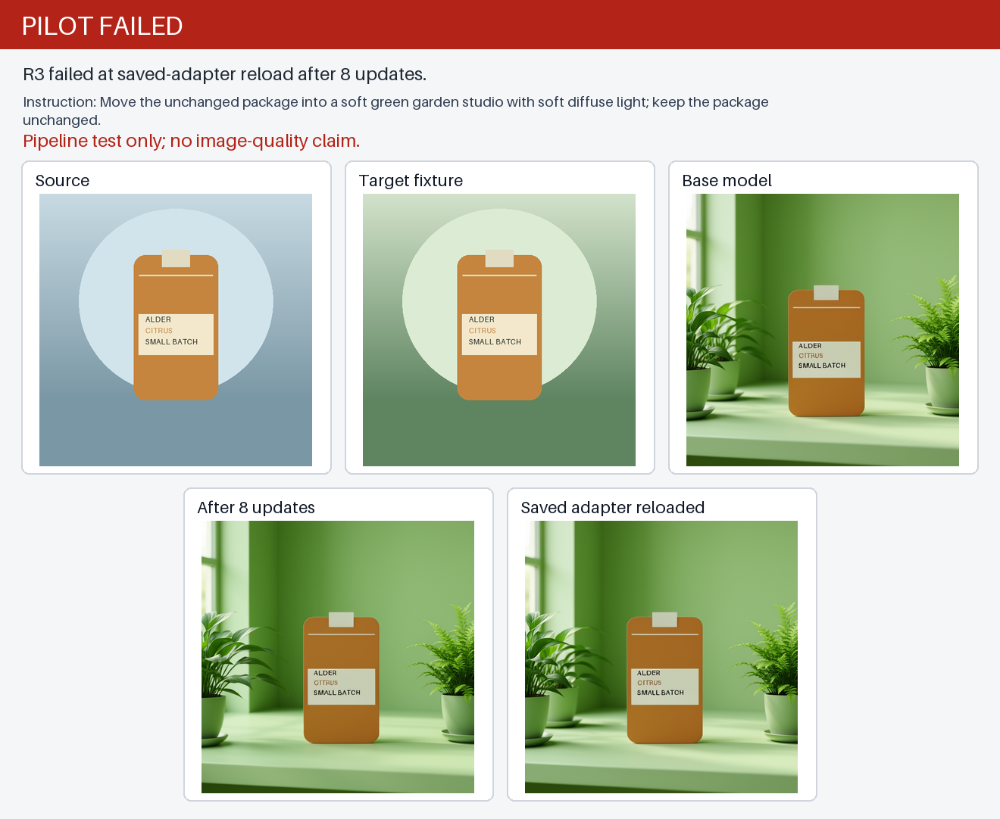

# FLUX.2 Klein R3 pilot result — 2026-10-08

**Result: failed at the saved-adapter reload check after eight updates.** The worker saved the adapter and three output PNGs, then stopped when the reloaded generation failed the explicit parity tolerance. This was a synthetic pipeline test, not a product-image quality evaluation.

The development example was `pack-006-garden_studio`, held out from the eight training pairs. The base model already made the green scene visible; this run does not establish an image-quality improvement.

## Measurements

| Check | Result |
|---|---|
| Losses | 8 of 8 finite losses |
| Gradients | 8 of 8 steps finite and nonzero; 200 gradient tensors per step |
| Optimizer updates | 8 |
| Saved adapter | `step-8.safetensors`, 96,364,672 bytes |
| PNG outputs | Base, trained, and reloaded images are each 512×512 |
| Reload parity | Trained vs. reloaded average absolute channel difference 7.8157 /255 (limit 2); 25.80% of pixels differed by more than 8 (limit 1%) — **failed** |
| Worker elapsed time | 129 seconds, including downloads, generations, and training; the failure receipt has no isolated training time or peak-memory measurement |

The R3 receipt records failure stage `adapter_reload` with `RuntimeError: reloaded adapter generation exceeded the explicit pixel tolerance`. The archive preserves the reloaded PNG written before that check. No quality improvement is claimed.

## Operations and cost

The Modal app is confirmed stopped with zero tasks. The stop command returned exit 1 with “already stopped”; this is consistent with the recorded stopped app state.

The estimated resource bound was about $2.67 and excludes image build, storage, and transfer. The shutdown snapshot shows a delayed/revisable workspace metered total of $4.55498935 and billed total of $0; it is not a per-run invoice. The actual R3 charge is unknown. R1 and R2 pre-GPU configuration rejections remain preserved, and R3 had no automatic retry.

The repository remains private and personal. No paid LLM-generated data was used. Before any further training, diagnose why the reloaded adapter output differs from the in-memory trained output.

## Review files

The original PNGs are preserved byte-for-byte; the contact sheet only resizes them to fit its panels.

- [Contact sheet](assets/pilot-r3/contact-sheet.png)
- [Source](assets/pilot-r3/source.png)
- [Target fixture](assets/pilot-r3/target-fixture.png)
- [Base model](assets/pilot-r3/base-model.png)
- [After 8 updates](assets/pilot-r3/after-8-updates.png)
- [Saved adapter reloaded](assets/pilot-r3/saved-adapter-reloaded.png)

## Source and execution pins

- Executed source commit: [683fc3a2eefed6d5d502e10f4c4db6209c6d8bce](https://github.com/1337mus/scenetune/commit/683fc3a2eefed6d5d502e10f4c4db6209c6d8bce)
- Exact CI run: [37860248287](https://github.com/1337mus/scenetune/actions/runs/37860248287)
- DiffSynth-Studio revision: [ee631d4907d8d6fc3d39063a2a65c00a954c9bf5](https://github.com/modelscope/DiffSynth-Studio/commit/ee631d4907d8d6fc3d39063a2a65c00a954c9bf5)
