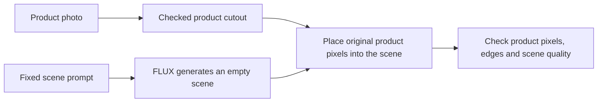

# Keeping the product while changing its scene

## Why test a different method?

Our earlier edits changed some product colors, shapes and small text.
More training did not give a clear gain on the three real development photos.

This comparison tests a different image pipeline:

The product stays in place. FLUX supplies the background.
This can preserve the product without asking FLUX to redraw its label.
A CPU check on two old development photos found a visible duplicate package
when we pasted the source over a full-image edit. Both cases kept product pixels
but failed visually. We will generate an empty scene before compositing.
It does not guarantee a clean cutout, natural shadows or good lighting.

## Current stage

All 24 accepted source photos and masks, and the 6/18 split, were reviewed and frozen before launch. The first one-shot comparison run stopped during its first image generation because the remote image did not have a C compiler. The app is stopped with zero tasks; it produced no images or quality scores. Reserved generated outputs remain unopened. No training ran.

The local image-builder fix installs `build-essential` and checks `cc`, `c++` and `make` before inference. CPU tests check the image-builder configuration. A real remote build has not verified the fix. There is no automatic retry. See the [failure report](protected-product-comparison-failure-2026-10-12.md).

| Item | Frozen plan | Attempt 1 |
| --- | --- | --- |
| Input set | 24 accepted ABO catalog cutouts | Same frozen payload; all 24 source photos and masks reviewed |
| Pool split | 6 development / 18 reserved | Unchanged; reserved generated outputs unopened |
| Cutout review | 18 original, 3 repaired, 3 replacements | All 24 accepted before launch |
| Methods | Full-image edit; empty-scene generation plus original product | First full-image edit failed before output |
| Model calls | 48 main calls plus 4 fresh-model replays (52 total) | 1 attempted; 0 succeeded |
| PNG artifacts | 78 planned across outputs, composites and replays | 0 produced |
| Training updates | 0 | 0 |
| Model and compute | FLUX.2 Klein Base 4B; one A100 80 GB, 4 CPU cores, 64 GiB RAM | Base pipeline loaded once on CUDA in 21.88 seconds |
| Worker and shutdown | 300-second startup; 1,800-second execution; one call; zero retries | 115.77 seconds; one spawn; stopped with zero tasks |
| Allowance | $8, including the $1 mask reserve | Not a per-run charge or a spending cap |

The signed [source commit ab7a429](https://github.com/1337mus/scenetune/commit/ab7a429023893dee1e1d0b3bde19fe31c0fac7b3) passed exact [CI run 38190964224, attempt 1](https://github.com/1337mus/scenetune/actions/runs/38190964224). The frozen plan and payload were not changed after the failure. The earlier $15 pilot remains closed.

## How we prepare the photos

1. Download individual photos with their official product records.
2. Keep the download URL, license, attribution and file hashes.
3. Reject logos, transparent products, clipped objects and unclear boundaries.
4. Resize and pad each accepted photo to 512 × 512. Do not crop the product.
5. Create a draft product cutout. Review its outline against the source.
6. Accept a mask only after a recorded visual check.
7. Group whole brands and product families into separate pools.

ABO photos do not come with ready product masks.
A simple cutout works only on selected, clean backgrounds.
A failed mask must stay rejected; we will not count it as a model failure.

The first six-photo screen found two possible cutout candidates.
Four failed: transparent glass, faint edges, a clipped light fixture and a logo.
The sandal candidate also has a reflection that needs a separate check.
Both possible candidates failed the first actual mask check.
The planter produced separate large regions. The sandal retained its reflection.
At that stage, no mask had passed. We kept those failures and did not relax the rules.

We then checked 30 more catalog photos. Six were unsuitable sources.
The simple mask method returned 20 drafts from the 24 remaining photos.
Four failed its checks. Visual review also found missing package regions and
retained background patches. A returned draft does not mean a good cutout.
None of these simple-method masks has been accepted.

The completed mask prerequisite used pretrained [BiRefNet Lite](https://huggingface.co/ZhengPeng7/BiRefNet_lite)
on the same 24 processed photos. It made 24 first-output calls and four repeat
calls, with two strict model loads. Training updates: zero.

| Mask prerequisite | Fixed limit |
| --- | --- |
| Compute | One A10, 2 CPU cores, 8 GiB RAM |
| Time | 180 seconds startup; 600 seconds execution; zero retries |
| Cost | Estimated compute $0.27; total step reserve $1 within the $8 allowance |
| Estimate excludes | Image builds, storage, transfer and shutdown lag |

The estimate was not a provider dollar cap. The mask check used no new photos or
training. The source, weights, input hashes and runtime versions were fixed before
that launch. Root reviewed the resulting cutouts, checked that the mask app had
stopped with zero tasks, and later froze the accepted set and 6/18 split for the
comparison. The mask standard was not lowered to fill the sample.

### Repaired mask check: initial review

The new run completed 24 first predictions and four exact repeat predictions.
Both strict model loads passed. The worker took 16.9 seconds on one A10.
The independent checker passed, and the app is stopped with zero tasks.

The initial assistant review of all 24 unscaled sources and cutouts accepted 18
outlines. Six needed correction: four lost package regions, one lost part of a
USB hub, and one retained a drop shadow. Those drafts were preserved; the final
accepted set is listed below.

[Full cutout result and limits](product-cutout-check-2026-10-12.md).

### Final input checks

| Source of accepted cutouts | Products |
| --- | ---: |
| Original GPU drafts | 18 |
| Original drafts with checked CPU repairs | 3 |
| Replacement catalog photos with checked CPU masks | 3 |
| **Total** | **24** |

We kept the rejected drafts and excluded photos. One replacement needed a repair:
we removed white background trapped between a suitcase’s handle rails.
The source photo stayed unchanged.

Official product and image records check out. Whole brands and product families
were kept in separate pools. The final split and payload were frozen before
launch; the first attempt produced no images. These are selected,
clean catalog photos. Mask acceptance is an assistant judgment, not a ground-truth
segmentation score.

### First mask check: stopped before inference

The first run failed a model-file count check. It made zero predictions.
The app is stopped and has zero running tasks. We keep that failed run unchanged.

Hugging Face's summary lists 44,362,660 stored values. The pinned file header
lists 44,362,703. An independent header check confirmed the 43-value difference.
The float values match; the difference is in integer values.
This is a loading-check defect, not a mask-quality result.

The correction used the pinned file count and kept the full-file hash check.
Failed loads retain their observed details. A separately reviewed run used the
same photos, model and settings; the failed run was not restarted.

All earlier SceneTune product identities and development brands stay excluded.
Rendered ABO views do not count as real catalog photos.
Source photos, masks, private reviews and receipts stay outside Git initially.

## Keep the comparison fixed

Both methods use the same processed source photo and case seed.
Seeds start at 7,321 and increase in sorted case-ID order.
Both use 16 steps and guidance scale 4.
Prompts and settings stay fixed once the plan is frozen.

The empty-scene method receives no reference product image.
It must not generate another product behind the pasted original.
We check for extra objects, weak edges, floating products and poor shadows.

A fresh model load and four replay checks were part of the frozen plan, but none
ran: attempt 1 failed at its first generation. No visual review or quality score
is available, and reserved generated outputs remain unopened. Any future attempt
requires a separate reviewed plan and fresh source, data and usage checks. Verify
the remote image build before GPU inference. There is no automatic retry.

## What the numbers can tell us

| Check | What it establishes |
| --- | --- |
| Changed protected pixels | Whether the processed source product pixels stayed exact |
| Source and mask hashes | Which inputs the comparison used |
| Replay pixel agreement | Whether fresh loading reproduced the fixed cases |
| Visual product review | Whether the mask kept the intended product |
| Visual scene review | Whether edges, shadows, lighting and placement look usable |

The protected-pixel check is a property of compositing.
It is not evidence that the model learned better labels or shapes.
Resizing changes the original high-resolution photo before either method runs.
Our exact-pixel claim applies to the reviewed 512 × 512 source.

A usable result must keep the whole intended product, follow the scene request,
and have no obvious cutout gap, duplicate object or floating placement.
We will count each failure type separately.

The exploratory gate is at least 14 of 18 usable reserved-test composites
and at least four more usable cases than the ordinary edit.
All 18 must pass protected-pixel integrity. These small counts do not establish
broad superiority or performance on difficult, unscreened photos.

We will report all cases, failures and ties.
We will separate automated integrity checks from root visual judgments.
Root visual judgments are not a new human preference study.
We will not call pixel error a text-reading or realism score.

## Decide whether training is useful

More training is conditional. We first need a measured, useful remaining gap.

- If cutouts solve product preservation and scenes look good, build the demo.
- If backgrounds or scene fit still fail, identify the specific failure.
- If a checked training set can address that failure, propose 500–1,000 pairs.
- If masks remain unreliable, improve the mask step before training FLUX.

We will not add epochs to the old small dataset by default.
The next training plan needs matched targets and fresh reserved products.

## Data source

[Amazon Berkeley Objects](https://amazon-berkeley-objects.s3.amazonaws.com/index.html)
provides real catalog photos under CC BY 4.0.
The [official README](https://amazon-berkeley-objects.s3.amazonaws.com/README.md)
sets the attribution requirements.

Credit: Amazon.com; Matthieu Guillaumin, Thomas Dideriksen, Kenan Deng,
Himanshu Arora, Jasmine Collins and Jitendra Malik.
This work is not endorsed by the dataset authors or product brands.
