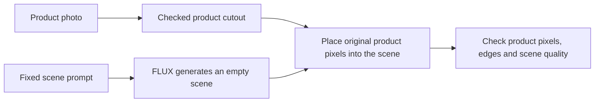

# Keeping the product while changing its scene

## Why test a different method?

Our earlier edits changed some product colors, shapes and small text.
More training did not give a clear gain on the three real development photos.

This comparison tests a different image pipeline:

The product stays in place. FLUX supplies the background.
This can preserve the product without asking FLUX to redraw its label.
A CPU check on two old development photos found a visible duplicate package
when we pasted the source over a full-image edit. Both cases kept product pixels
but failed visually. We will generate an empty scene before compositing.
It does not guarantee a clean cutout, natural shadows or good lighting.

## Current stage

The comparison is approved. Its input set is still being checked.
The first GPU mask check stopped before inference. It produced no masks.
The repaired check produced 24 drafts: 18 passed visual review; six need correction.
The full comparison remains pending. No new training has started.

| Item | Proposed comparison |
| --- | --- |
| Source photos | 24 new real catalog products from ABO |
| Development pool | 6 products |
| Reserved test pool | 18 products |
| Training updates | 0 |
| Methods | Ordinary full-image edit; empty scene plus original product |
| Generations | 48 main outputs plus 4 fresh-model replay checks |
| Output size | 512 × 512 pixels |
| Model | Frozen FLUX.2 Klein base 4B; no LoRA adapter |
| Compute | One A100 80 GB, 4 CPU cores, 64 GiB RAM |
| Limits | 300 seconds startup; 1,800 seconds execution; zero retries |
| New comparison allowance | $8 within the proposed $100–$150 project budget |

These are planning limits. They are not a provider dollar cap.
Root must freeze the data, source, plan and price check before launching.
The earlier $15 pilot remains closed. This comparison cannot restart it.

## How we prepare the photos

1. Download individual photos with their official product records.
2. Keep the download URL, license, attribution and file hashes.
3. Reject logos, transparent products, clipped objects and unclear boundaries.
4. Resize and pad each accepted photo to 512 × 512. Do not crop the product.
5. Create a draft product cutout. Review its outline against the source.
6. Accept a mask only after a recorded visual check.
7. Group whole brands and product families into separate pools.

ABO photos do not come with ready product masks.
A simple cutout works only on selected, clean backgrounds.
A failed mask must stay rejected; we will not count it as a model failure.

The first six-photo screen found two possible cutout candidates.
Four failed: transparent glass, faint edges, a clipped light fixture and a logo.
The sandal candidate also has a reflection that needs a separate check.
Both possible candidates failed the first actual mask check.
The planter produced separate large regions. The sandal retained its reflection.
No mask has been accepted yet. We kept those failures and did not relax the mask rules.

We then checked 30 more catalog photos. Six were unsuitable sources.
The simple mask method returned 20 drafts from the 24 remaining photos.
Four failed its checks. Visual review also found missing package regions and
retained background patches. A returned draft does not mean a good cutout.
None of these simple-method masks has been accepted.

The prerequisite check uses pretrained [BiRefNet Lite](https://huggingface.co/ZhengPeng7/BiRefNet_lite)
on the same 24 processed photos. It makes 24 first-output calls and four repeat
calls, with two strict model loads. Training updates: zero.

| Mask prerequisite | Fixed limit |
| --- | --- |
| Compute | One A10, 2 CPU cores, 8 GiB RAM |
| Time | 180 seconds startup; 600 seconds execution; zero retries |
| Cost | Estimated compute $0.27; total step reserve $1 within the $8 allowance |
| Estimate excludes | Image builds, storage, transfer and shutdown lag |

The estimate is not a provider dollar cap. This check uses no new photos or
training. All inference runs on Modal. The model revision, code, weights, input
hashes and runtime versions must be fixed before launch. The 6/18 development/test
group proposal is tentative and must stay unfrozen until masks are accepted.
Every generated mask remains a draft until root has reviewed it. Root must also
verify the app is stopped and has zero running tasks before accepting the mask
set. If any mask fails review or the stopped-zero proof is missing, the comparison
stays pending; do not lower the mask standard to fill the sample.

### Repaired mask check

The new run completed 24 first predictions and four exact repeat predictions.
Both strict model loads passed. The worker took 16.9 seconds on one A10.
The independent checker passed, and the app is stopped with zero tasks.

Assistant review of all 24 unscaled sources and cutouts accepted 18 outlines.
Six need correction: four lose package regions, one loses part of a USB hub,
and one retains a drop shadow. Preserve these drafts. Review any CPU corrections
separately before accepting the complete input set.

[Full cutout result and limits](product-cutout-check-2026-10-12.md).

### First mask check: stopped before inference

The first run failed a model-file count check. It made zero predictions.
The app is stopped and has zero running tasks. We keep that failed run unchanged.

Hugging Face's summary lists 44,362,660 stored values. The pinned file header
lists 44,362,703. An independent header check confirmed the 43-value difference.
The float values match; the difference is in integer values.
This is a loading-check defect, not a mask-quality result.

The correction uses the pinned file count and keeps the full-file hash check.
Failed loads will also retain their observed details. A new run needs a new
reviewed plan, passing checks and a fresh cost review. It will use the same photos,
model and settings. We will not restart the failed run.

All earlier SceneTune product identities and development brands stay excluded.
Rendered ABO views do not count as real catalog photos.
Source photos, masks, private reviews and receipts stay outside Git initially.

## Keep the comparison fixed

Both methods use the same processed source photo and case seed.
Seeds start at 7,321 and increase in sorted case-ID order.
Both use 16 steps and guidance scale 4.
Prompts and settings stay fixed once the plan is frozen.

The empty-scene method receives no reference product image.
It must not generate another product behind the pasted original.
We check for extra objects, weak edges, floating products and poor shadows.

A fresh model load repeats both methods on the first two development cases.
All four replay checks compare decoded pixels with their first outputs.
Test outputs stay closed until execution, replay and shutdown checks pass.
Root must confirm the app stopped and has zero running tasks.

## What the numbers can tell us

| Check | What it establishes |
| --- | --- |
| Changed protected pixels | Whether the processed source product pixels stayed exact |
| Source and mask hashes | Which inputs the comparison used |
| Replay pixel agreement | Whether fresh loading reproduced the fixed cases |
| Visual product review | Whether the mask kept the intended product |
| Visual scene review | Whether edges, shadows, lighting and placement look usable |

The protected-pixel check is a property of compositing.
It is not evidence that the model learned better labels or shapes.
Resizing changes the original high-resolution photo before either method runs.
Our exact-pixel claim applies to the reviewed 512 × 512 source.

A usable result must keep the whole intended product, follow the scene request,
and have no obvious cutout gap, duplicate object or floating placement.
We will count each failure type separately.

The exploratory gate is at least 14 of 18 usable reserved-test composites
and at least four more usable cases than the ordinary edit.
All 18 must pass protected-pixel integrity. These small counts do not establish
broad superiority or performance on difficult, unscreened photos.

We will report all cases, failures and ties.
We will separate automated integrity checks from root visual judgments.
Root visual judgments are not a new human preference study.
We will not call pixel error a text-reading or realism score.

## Decide whether training is useful

More training is conditional. We first need a measured, useful remaining gap.

- If cutouts solve product preservation and scenes look good, build the demo.
- If backgrounds or scene fit still fail, identify the specific failure.
- If a checked training set can address that failure, propose 500–1,000 pairs.
- If masks remain unreliable, improve the mask step before training FLUX.

We will not add epochs to the old small dataset by default.
The next training plan needs matched targets and fresh reserved products.

## Data source

[Amazon Berkeley Objects](https://amazon-berkeley-objects.s3.amazonaws.com/index.html)
provides real catalog photos under CC BY 4.0.
The [official README](https://amazon-berkeley-objects.s3.amazonaws.com/README.md)
sets the attribution requirements.

Credit: Amazon.com; Matthieu Guillaumin, Thomas Dideriksen, Kenan Deng,
Himanshu Arora, Jasmine Collins and Jitendra Malik.
This work is not endorsed by the dataset authors or product brands.
