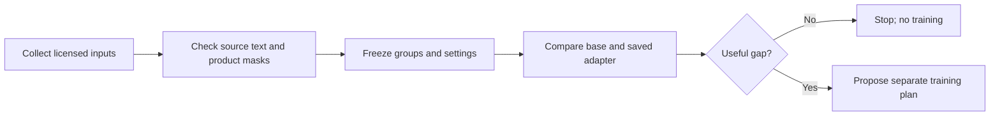

# Real-photo evaluation plan

## Candidate photo source

Raj reports that he completed the [OFF API-use form](https://docs.google.com/forms/d/e/1FAIpQLSdIE3D8qvjC_zRJw1W8OmuHhsWJ_NSckiiniAHlfaVwUZCziQ/viewform). The first small collection is complete. Open Food Facts (OFF) remains a candidate source for private evaluation; photo ownership and camera origin are not independently proved. See the [OFF terms](https://world.openfoodfacts.org/terms-of-use) and [API documentation](https://openfoodfacts.github.io/openfoodfacts-server/api/).

OFF product images use CC BY-SA 3.0. This covers the photos only. Product text, logos, people, and other third-party content may have separate rights. Record each photo's source, creator, license, and required attribution. A SHA-256 is a file fingerprint. It identifies an exact file, but not look-alike photos. Keep photos and crops private; do not put them in Git.

The sample goal is 6–9 suitable input photos across at least three product families. We collected six candidates; three look like camera photos and three have uncertain packshot origins. See the [source check](real-photo-source-check-2026-10-10.md). This is a starting point, not a fixed evaluation size. Group photos by product identity, package family, and near-duplicate/photo session before assigning train, development, and test pools. Until photo selection is complete, reserve test identities in metadata only. Keep test photos, masks, labels, and thumbnails closed.

| Pool | Use | Boundary |
|---|---|---|
| Development | Compare base and saved adapter | Whole product/family groups; no target photo needed |
| Train | Only for a future, separate training proposal | Target pairs are collected separately |
| Test | Final check after method and criteria are frozen | Keep content closed; metadata only until photo selection is complete |

## Photo checks

The CPU checker, `verify_intake`, reads `intake.json`. It checks original files and credits, and checks train, development, and reserved groups. Passing intake checks alone does not make photos ready for model evaluation. Masks, text annotations, and human review are still needed. File hashes do not find look-alike photos; review near-duplicates and families separately.

## What we will test

Compare the original base and existing saved adapter on the same licensed input photos. Match prompts, references if used, seeds, resolution, steps, guidance, and other settings. No paired target photo is needed. Record the exact model and code versions. Check that the saved adapter reloads correctly. Keep model and OCR inference remote. Use the laptop for CPU-side intake, grouping, manifests, and hashes.

Human reviewers must check source masks and visible-word annotations before scoring, and review outputs. This plan or assistant-written summaries do not count as human QA. Annotate visible words and fixed word regions. Report source readability separately. Freeze text normalization and metrics before viewing generated outputs. Do not use paid LLM judges or generated captions.

Report these results separately:

- **Product preservation:** compare source and output inside a fixed source mask only when the prompt freezes position and shape. Output shifts can invalidate mask agreement; report shifts separately and mark the pixel comparison inapplicable. Fixed-position pixel error is not a shape or OCR score.
- **Label correctness:** use the frozen word annotations and normalization. Keep source readability separate from generated-text correctness.
- **Background realism:** use a separate human rubric. Do not claim target-pixel agreement; a target photo is not required.

Show every example, failure, and exclusion. Report runtime, peak memory, and usage evidence. Consider training only if the comparison finds a repeatable, useful gap. Any future paired-training target photos need their own source checks and proposal.

## Before compute

The initial $15 pilot allowance still applies. Any future run needs fixed model and code versions, passing checks on that code, current usage checks, and a reviewed plan with time and cost limits. This document does not approve a GPU launch.
