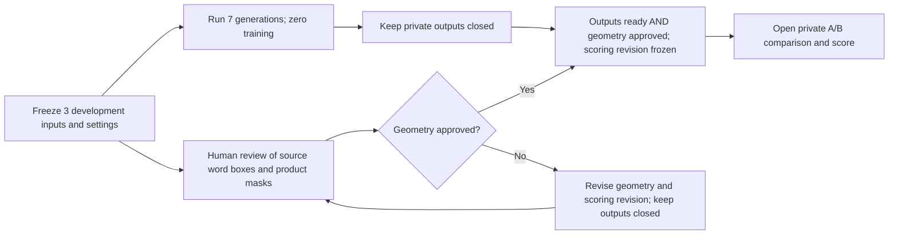

# Real-photo evaluation plan

## Candidate photo source

Raj reports that he completed the [OFF API-use form](https://docs.google.com/forms/d/e/1FAIpQLSdIE3D8qvjC_zRJw1W8OmuHhsWJ_NSckiiniAHlfaVwUZCziQ/viewform). The first small collection is complete. Open Food Facts (OFF) remains a candidate source for private evaluation; photo ownership and camera origin are not independently proved. See the [OFF terms](https://world.openfoodfacts.org/terms-of-use) and [API documentation](https://openfoodfacts.github.io/openfoodfacts-server/api/).

OFF product images use CC BY-SA 3.0. This covers the photos only. Product text, logos, people, and other third-party content may have separate rights. Record each photo's source, creator, license, and required attribution. A SHA-256 is a file fingerprint. It identifies an exact file, but not look-alike photos. Keep photos, prepared images, masks, and generated outputs private and out of Git.

We collected six candidates. Three look like camera photos and three have uncertain packshot origins. See the [source check](real-photo-source-check-2026-10-10.md). The current comparison uses three development products, listed below. No final-test pool is defined. Keep future test photos, masks, labels, and thumbnails closed.

| Pool | Use | Boundary |
|---|---|---|
| Development | Compare base and saved adapter | Three selected product identities; no target photo needed |
| Train | Only for a future, separate training proposal | Separate target pairs and approval are required |
| Test | No pool defined | Keep future content closed until method and criteria are frozen |

## Photo checks

The CPU checker, `verify_intake`, reads `intake.json`. It checks original files and credits, and checks train, development, and reserved groups. Passing intake checks alone does not make photos ready for model evaluation. Masks, text annotations, and human review are still needed. Raj confirmed the seven listed text labels; boxes around text and product outlines remain unreviewed. File hashes do not find look-alike photos; review near-duplicates and families separately.

## Frozen comparison

The frozen development set has three private products: Barilla (OFF-R1-003), Kinder Bueno (OFF-R1-005), and Quaker Cruesli (OFF-R1-006). Keep all three out of training and the final test set.

The proposed comparison has seven generations on the same frozen inputs and prompt: three from the base model, three from the saved step-144 adapter, and one fresh strict-load repeat for one case. It uses zero training. All seven use 512×512 images, seed 7321, 16 steps, and guidance 4. No paired target image is needed.

Raj confirmed the seven source text labels. Their text boxes and the product masks still need review. Geometry review gates opening generated outputs and quality scoring. It does not gate inference on the frozen inputs. Keep outputs closed until geometry review passes. Freeze the scoring revision before opening outputs.

Cruesli is a cropped package front. Its mask covers the visible crop only and makes no whole-package shape claim.

Use human reviewers for evaluation. Reviewers will transcribe output words and assess the fixed rubrics. Do not use OCR, paid LLM judges, or generated captions. This plan and assistant-written summaries do not count as human QA. Freeze text normalization and metrics before opening outputs.

Report three measures separately, with no combined score or broad quality claim:

- **Label correctness:** compare the fixed visible words with human transcripts. Keep source readability separate from generated-text correctness.
- **Product preservation:** compare source and output inside a fixed source mask only when the prompt freezes position and shape. Output shifts can invalidate mask agreement; report shifts separately and mark pixel comparison inapplicable. Fixed-position pixel error is not a shape or OCR score.
- **Background realism:** use a separate human rubric. Do not claim target-pixel agreement; a target photo is not required.

Show every example, failure, and exclusion. Report runtime, peak memory, and usage evidence if a run is later approved.

## Before compute

No real-photo GPU run has happened, so this comparison has no generated outputs or scores. No launch is approved. The initial $15 pilot allowance still applies. Any future run needs fixed model and code versions, passing checks on that code, current usage checks, and a reviewed plan with time and cost limits. This document does not approve a GPU launch.
