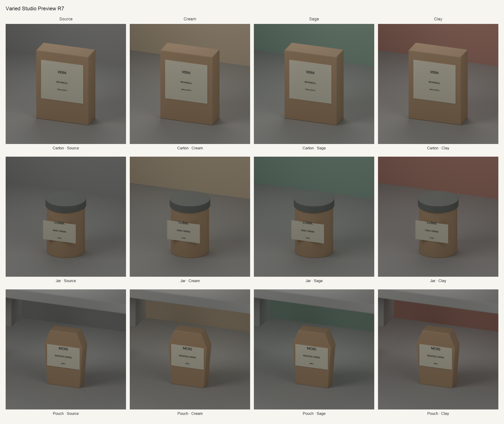

# Varied studio preview (2026-10-11)

**Status:** Development preview. Structural checks passed. These images are not approved for training.

The run generated source, cream, sage, and clay variants for a carton, jar, and pouch. All variants use one canonical neutral-wall/support family.

Individual sheets: [carton](assets/varied-studio-preview/contact-sheet-carton.png) · [jar](assets/varied-studio-preview/contact-sheet-jar.png) · [pouch](assets/varied-studio-preview/contact-sheet-pouch.png)

## Run

| Measure | Result |
|---|---|
| Output | 12 images across 3 products; 12 captured snapshots |
| Render | CPU, 2 threads; 96 samples; 512×512; denoising and adaptive sampling off |
| Time | 159.567 s rendering; 215.806 s receipt wall time; 220.615 s wrapper elapsed |
| Compute | 0 GPU runs; 0 training updates |
| White clipping | 0 clipped-white pixels in each of the 12 images |

The run recorded 39 observations of mesh normals (surface directions), tracked 25 mesh identities, performed 7 geometry bakes to prepare selected meshes, and recorded 28 full-payload hashes. These are run-accounting counts, not distinct test counts.

## Pixel comparison

Mean absolute per-channel RGB differences from source on a 0–255 scale, averaged across cream, sage, and clay for each product. Whole product includes the interior and edge regions. Lower means less RGB change; these values are not model scores or quality thresholds.

| Shape | Whole product | Interior | Edge | Background |
|---|---:|---:|---:|---:|
| Carton | 0.251 | 0.231 | 0.903 | 4.999 |
| Jar | 0.430 | 0.409 | 0.938 | 4.953 |
| Pouch | 0.147 | 0.135 | 0.430 | 2.419 |

Each product's four black-and-white masks decoded pixel-identically; positions appear stable across variants.

The interior excludes a two-pixel band around the outline; that band is the edge.

Wall colors change, while grain and low contrast remain. The jar mask includes a protruding label board that reads as a flat card, with “LUMA” crossing its upper edge. The pouch reads as rigid packaging. The original contact sheets are preserved; the linked sheets use corrected tiles that match the renders exactly.

## Limits

- **Training:** These development previews are excluded from fresh data pools; data acceptance and future-training eligibility are false. Earlier R1–R6 failures remain preserved, and this run does not establish that their causes were fixed.
- **Reconstruction:** Eighteen unbaked non-product full payloads are unavailable, so the recount cannot independently reconstruct those composites.
- **Capture and decoding:** The checker has no independent numeric decoder for Short2, and captured-state validation does not establish capture completeness.
